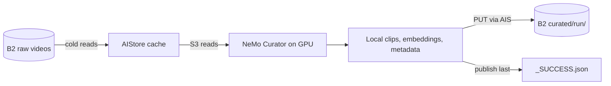

# Video Curation on Backblaze B2 with AIStore and NeMo Curator

Read raw videos from Backblaze B2 through an AIStore (AIS) cache, split them into clips and generate Cosmos-Embed1 embeddings with NVIDIA NeMo Curator, and publish the results back to B2 with a verifiable manifest.

## Prerequisites

Steps marked **any machine** run on a CPU-only Linux or macOS host with Python 3.11 or newer. Steps marked **GPU host** need the GPU items below.

- [ ] A B2 bucket and an application key restricted to it with `listBuckets`, `listFiles`, `readFiles`, `writeFiles`
- [ ] Docker with Compose v2, `curl`, and `shasum`
- [ ] [uv](https://docs.astral.sh/uv/)
- [ ] **GPU host:** Linux x86_64, an NVIDIA GPU, a CUDA 13-compatible driver (580.65.06 or newer), and the CUDA 12 toolkit for Curator's native video extensions. The locked PyTorch wheel supplies its CUDA 13 runtime. See [NVIDIA's video curation guide](https://docs.nvidia.com/nemo/curator/v26.07/get-started/video) for GPU sizing.
- [ ] **GPU host:** system FFmpeg and ffprobe 8.0+ with the selected encoder and its software decoder: `h264_nvenc` / `h264` for NVENC, or `libvpx-vp9` / `vp9` for CPU VP9. Check with `ffmpeg -version`, `ffprobe -version`, `ffmpeg -hide_banner -encoders`, and `ffmpeg -hide_banner -decoders`.
- [ ] **GPU host, NVENC:** NVIDIA's video-encoding runtime library (`libnvidia-encode.so.1`) matching the installed driver. FFmpeg's encoder listing alone does not confirm runtime availability; `make run` exercises the encoder before accessing storage.

## Quickstart

```bash
cp .env.example .env    # any machine: fill in B2 settings and the bucket-scoped key
make setup              # any machine: locked Python env + checksum-verified Curator script
make up                 # any machine: start AIS on 127.0.0.1:51080, attach s3://$B2_BUCKET
make seed               # any machine: copy the pinned 50-video subset (~60 MB) into raw/
make run ARGS="--dry-run"
make setup-curator      # GPU host: NeMo Curator in .venv-curator
make run                # GPU host: prefetch raw/, curate, publish to curated/<run-id>/
```

| Step | Expected output |
|---|---|
| `make setup` | `.cache/curator/video_split_clip_example.py: OK` |
| `make up` | `attached s3://<bucket> -> https://s3.<region>.backblazeb2.com (region <region>) at http://127.0.0.1:51080` |
| `make seed` | `s3://<bucket>/raw/: 50 uploaded, 0 unchanged` (re-runs report `0 uploaded, 50 unchanged`) |
| `make run ARGS="--dry-run"` | `AWS_ENDPOINT_URL=http://127.0.0.1:51080/s3 ...`, the exact Curator command |
| `make setup-curator` | uv finishes installing into `.venv-curator` |
| `make run` | `Curator stage: 0 B2 GETs, 0 bytes (AIS backend counters)`, then `wrote N objects to s3://<bucket>/curated/<run-id>/ (via AIS -> B2)` |

`make help` lists every target. The GPU lock includes packages that build native extensions, so install the matching CUDA toolkit and host compiler before `make setup-curator`.

## Running on a cloud GPU

Run the quickstart on a Linux GPU workstation or cloud VM with Docker and the prerequisites above. Cloud instances often have small root disks, so put the cache and Curator's work directory on mounted local NVMe storage; use `lsblk` to identify the mount:

```bash
echo 'AIS_CACHE_DIR=/mnt/nvme/ais' >> .env      # AIS cache, applied on the next `make up`
make run ARGS="--work-dir /mnt/nvme/work --video-limit 10"
```

On Kubernetes platforms such as CoreWeave, or pods without a Docker daemon, deploy AIS with [ais-k8s](https://github.com/NVIDIA/ais-k8s) with the B2 key as its AWS backend credentials. Then set `AIS_ENDPOINT` in `.env` to its proxy and run `make attach` instead of `make up`. Keep that cluster private to the job; see [docs/operations.md](docs/operations.md).

## Architecture



AIS caches remote inputs and writes uploads through to B2. The wrapper (`scripts/run_pipeline.py`) launches the pinned Curator tutorial: botocore and s3fs pick up `AWS_ENDPOINT_URL`, so every Curator read goes through AIS. Curator 1.4.0 writes only to local paths, so output lands in `work/<run-id>/` and is then uploaded through AIS.

`make setup-curator` applies a checksum-guarded compatibility fix to Curator 1.4.0: remote file-group IDs normalize `FSPath` values to strings before hashing. The original path objects remain intact for reads. Setup accepts only the known upstream file or its already patched form and fails on unexpected source. Ray workers use `.venv-curator`; the launcher's automatic uv environment propagation is disabled for the Curator subprocess.

The GPU environment includes the video stages needed for clips and embeddings, without the optional vLLM captioning stack. Before Curator starts, the entrypoint verifies the pinned tutorial and omits its unused captioning imports. It downloads Cosmos-Embed1 at a fixed revision, verifies the SHA-256 of its code, configuration and safetensors weights, and applies a checksum-guarded Transformers 5 compatibility adaptation. This retains the original attention-mask math and restores the model's normalization constants after weight loading. Cached artifacts are verified on subsequent runs; unexpected changes stop the run before model code executes.

**Media preflight.** Before any storage access, the wrapper checks FFmpeg versions and codecs and performs a small in-memory encode with the selected encoder, which catches missing runtime NVENC support. `--encoder auto` selects NVENC, or CPU VP9 on recognized GPUs without NVENC (A100, H100); pass `--encoder libvpx-vp9` when hardware encoding is unavailable. `--dry-run` skips preflight and storage work.

**Prefetch.** Full runs prefetch the input prefix into AIS first, so Curator reads only cached data. A failed or timed-out prefetch stops the run before Curator starts; pass `--skip-prefetch` to read cold through AIS instead. Runs with `--video-limit` skip prefetch and read their selected videos on demand.

**Failures and interrupts.** If Curator fails, its local output is kept and nothing is published; start a fresh run. SIGINT and SIGTERM are forwarded to the wrapper's local process group, which gets 30 seconds before remaining workers are killed; interrupted runs exit 130 or 143 and keep local output unpublished. After a successful launcher exit, remaining workers get 5 seconds to exit on their own; any still running then are stopped and the run counts as failed. If upload fails after successful processing, retry publication from the kept output ([below](#publication-protocol)) rather than rerunning Curator into that directory.

### Publication protocol

Seeded inputs and curated outputs are published as a prefix with a `_SUCCESS.json` record:

1. Hash every local file with SHA-256.
2. Write `_SUCCESS.json` with status `pending` and no files. This invalidates any earlier publication at that prefix before data changes.
3. Upload each object with its SHA-256 in user metadata. An object is skipped only when its size and SHA-256 already match, from metadata or a previous complete record (AIS can omit user metadata on HEAD). Multipart ETags are never used as content hashes.
4. Check that the local tree did not change during upload (paths plus size, mtime, ctime and inode; bytes are not re-read), then replace the record with status `complete`, every file's size and SHA-256, and provenance.

```json
{
  "schema_version": 1,
  "status": "complete",
  "files": {"clips/example.mp4": {"size": 123, "sha256": "<64 hex characters>"}},
  "provenance": {"curator_version": "1.4.0", "input_manifest_sha256": "<64 hex characters>"}
}
```

Consumers accept only schema version 1 with status `complete`, verify every listed size and SHA-256, and ignore unlisted objects, including leftovers from an earlier failed publication. `input_manifest_sha256` is the SHA-256 of the input's `_SUCCESS.json` re-serialized with sorted keys (equal to its `sha256sum` when these tools wrote it; `null` when the input has none), so each output traces to the exact input it was built from. Object stores have no atomic directory upload; the record written last is what makes a prefix safe to consume. A failed transfer leaves the record `pending`.

One writer owns each remote prefix; do not share run IDs across hosts. After a failed upload, keep the source tree and retry with `storage.upload_dir(..., publish=True)`, passing the original `provenance=` so the output keeps its lineage; files that already match are skipped. If the source is lost or changed, publish under a new run ID.

```bash
make verify PREFIX=curated/<run-id>                  # through AIS
make verify PREFIX=curated/<run-id> ARGS="--direct"  # B2's durable copy
```

Verification streams every listed object, checks its size and SHA-256, then rereads the record to detect a concurrent republish.
It reports files verified and bytes read to stderr at startup, about every five seconds as data arrives, and on completion. The final `verified N files` line on stdout appears only after all checks pass. Progress updates pause while waiting on network reads.
It prints its file count only after completion; large publications can take several minutes without intermediate output.

### Scope

- Output is clips and embeddings. Captioning is not included. A downstream Cosmos trainer may need filtering, deduplication, splits, tokenization, or format conversion.
- The sample measures B2 traffic, not curation speed or model quality.
- The Compose stack is a single-host demo: one proxy, one target, no authentication, ports bound to `127.0.0.1`. See [docs/operations.md](docs/operations.md) for remote deployments.
- The GPU lock pins Python packages and the PyTorch CUDA runtime. Host drivers and the build toolkit are installed separately. Cosmos-Embed1 code and weights are pinned and checksum-verified by the entrypoint.

## Configuration

| Variable | Purpose |
|---|---|
| `B2_ENDPOINT`, `B2_REGION`, `B2_BUCKET` | B2 S3 endpoint, region, and existing bucket |
| `B2_KEY_ID`, `B2_APP_KEY` | Bucket-scoped key for `make up`, seeding, and direct verification and benchmarks |
| `AIS_ENDPOINT` | AIS proxy; default `http://127.0.0.1:51080` |
| `AIS_PORT`, `AIS_TARGET_PORT` | Compose host and container ports; change both plus `AIS_ENDPOINT` |
| `AIS_IMAGE` | Override the digest-pinned AIS image |
| `AIS_CACHE_DIR` | Host path for the AIS cache (e.g. local NVMe); default is a Docker volume |
| `HF_TOKEN` | Optional Hugging Face token |
| `B2_IT` | Set to `1` to opt in to `make test-integration` |

`.env` is shell-sourced for storage operations, so quote values containing spaces or `#`. Unit tests never source it.

`make run` options: `--input-prefix` (default `raw`), `--output-prefix` (default `curated`), `--run-id`, `--work-dir`, `--model-dir`, `--clip-seconds`, `--video-limit`, `--encoder`, `--skip-prefetch`, `--dry-run`. Other flags are forwarded to Curator, except input, output, model path, encoder, clip duration, embedding model, and captioning flags. The sample uses the verified Cosmos-Embed1 224p model. Default run IDs contain a timestamp and random suffix; an explicit `--run-id` must be a single identifier, and an existing `work/<run-id>/` is refused.

To curate your own videos, seed them under a new immutable prefix per dataset revision. AIS keeps serving cached objects for a prefix, so overwriting inputs in place can return old data.

```bash
set -a; . ./.env; set +a
uv run --locked python scripts/seed_b2.py --local-dir ./my_videos --prefix raw/revision-001
make run ARGS="--input-prefix raw/revision-001 --video-limit 5"
```

Seeding writes directly to B2. Curator reads every video under the selected prefix; the seed manifest does not filter its input. When the prefix has a `_SUCCESS.json`, `run_pipeline.py` requires it to be complete and to list exactly the objects present (by key and size), so an interrupted seed or leftovers from an earlier one are refused. A prefix with no manifest is curated as-is.

## Benchmarks

```bash
make bench ARGS="--prefix raw/ --limit 50 --workers 16"
```

`benchmarks/read_throughput.py` compares direct B2 reads, AIS cold reads, and AIS warm reads. Cold mode evicts only the selected keys; warm mode fills them before timing. Reads stream in bounded chunks. Reports include wall time, MB/s, p50/p99 latency, and measured B2 GETs and bytes: client GETs in `b2-direct` mode, and deltas of the AIS target's `aws.get.n` / `aws.get.size` counters in AIS modes. They are written to `results/read_throughput-<timestamp>.{json,md}` (change with `--out-dir`). `--workers` sets concurrent GETs per mode (default 16). The counters are cluster-wide, so run on an otherwise idle cluster. `--drop-caches` drops the client's page cache on Linux; remote AIS targets need separate treatment. Record link bandwidth (`--link-gbps`), dataset size, and host configuration with results, and use B2 reports and [current B2 pricing](https://www.backblaze.com/cloud-storage/pricing) for cost. This repository publishes no numbers.

## Tests

```bash
make check              # lint + offline unit tests (what CI runs, Python 3.11 and 3.12)
make audit              # scan both locked environments; requires network access
make test-integration   # real B2, opt-in
```

Integration tests run against real B2 through a disposable AIS cluster under its own Compose project on ports 51280/51281, started cold and removed with its cache on exit. They assert that cold reads hit B2 once and that warm reads and the post-prefetch Curator stage hit it zero times, using AIS backend GET counters. They also cover multipart writes, content identity, publication verification, and a Curator-shaped fsspec subprocess; there is no GPU inference. Requirements:

- a dedicated test bucket and a key scoped to it with `listBuckets`, `listFiles`, `readFiles`, `writeFiles`, set in `.env` with `B2_IT=1`;
- a B2 lifecycle rule on prefix `it/`: each run writes ~13 MB under a unique `it/<timestamp>-<hex>/` prefix and deletes nothing;
- Docker, with ports 51280 and 51281 free.

## Security

- Use a bucket-scoped key with only `listBuckets`, `listFiles`, `readFiles`, `writeFiles`. The publication protocol never deletes.
- Only the AIS target container and the direct-to-B2 tools (seed, benchmark, `verify --direct`) receive the B2 key. Curator subprocesses get placeholder S3 credentials and the AIS endpoint.
- AIS runs without authentication and the placeholder credentials provide no access control, so keep the stack on localhost. Remote deployments need AuthN and TLS; see [docs/operations.md](docs/operations.md).
- `.env` is git-ignored and secrets are excluded from `Config` repr.
- Uploads reject symlinks inside the tree. The work directory itself may be a symlink (e.g. to local NVMe); it is resolved once at startup.
- `make down` keeps the cache and proxy identity volumes. `docker compose -f deploy/docker-compose.yml down -v` removes them, not B2 objects; B2 is the recovery source.

## Troubleshooting

| Symptom | Fix |
|---|---|
| Port 51080 in use on `make up` | Set `AIS_PORT`, `AIS_TARGET_PORT`, and `AIS_ENDPOINT` in `.env`. |
| `create-bck failed` or `AIS cannot list s3://...` from `make up`, often `ErrRemoteBckNotFound` | Check `B2_ENDPOINT`, `B2_REGION`, `B2_BUCKET`, and the key's capabilities, then re-run `./scripts/attach_b2_bucket.sh` with `.env` loaded (idempotent). |
| `split-brain` in proxy logs after recreating containers | Proxy state lives in the `proxy_conf` volume. Reset with `docker compose -f deploy/docker-compose.yml down -v`; this drops the cache, not B2 data. |
| `AIS unreachable at ...; run make up` | Start AIS with `make up`, or point `AIS_ENDPOINT` at a running cluster. |
| `AIS unreachable ...; local output kept in work/<run-id>` | Run `make up`, then rerun with a new `--run-id`, or publish the kept output with `storage.upload_dir(..., publish=True)`. |
| `work/<run-id> already exists; choose a new --run-id` | Pass a new `--run-id` or omit it for a generated one. |
| `.venv-curator/... not found; run make setup-curator` | Run `make setup-curator` on the GPU host. |
| `...; see README media prerequisites` | Install FFmpeg 8.0+ with the selected encoder, or pass `--encoder libvpx-vp9`. |
| `Cannot load libnvidia-encode.so.1` | Install the NVIDIA video-encoding runtime library matching the installed driver and ensure it is visible to the dynamic linker. |
| Nonzero `Curator stage: N B2 GETs` | Expected with `--video-limit` or `--skip-prefetch`, which read cold through AIS. |

## Pins

| Component | Pin |
|---|---|
| NeMo Curator | `1.4.0` |
| Curator tutorial script | commit `10fba1ea785863872ae6983b580ec6813e72cc79`, SHA-256 verified by `make setup` |
| GPU Python environment | `deploy/curator/uv.lock`, Linux x86_64 / Python 3.12 |
| Transformers | `5.21.0` in the GPU lock; checksum-guarded Cosmos-Embed1 compatibility adaptation |
| PyTorch / torchvision | `2.13.0` / `0.28.0`; CUDA 13 runtime |
| CPU Python environment | `uv.lock` |
| AIStore image | `aistorage/cluster-minimal:v5.1`, pinned by digest in `deploy/docker-compose.yml` |
| AIStore Python SDK | `aistore==2.0.0`, moves with the image |
| Seed dataset | `nvidia/PhysicalAI-Robotics-GR00T-X-Embodiment-Sim` @ `ea7ac0b68f87da62f1e726771bba0fe74300802f` |

Cosmos-Embed1 downloads on first use at revision `787e0b996f5260a71ad474a283c90539a2e12986`. The entrypoint verifies its artifact checksums and the output manifest records the model revision. Record the driver and build toolkit versions for a reproducible experiment.

## Licenses and disclaimer

| Item | License | In this repo |
|---|---|---|
| Sample code | Apache-2.0 ([LICENSE](LICENSE)) | yes |
| `deploy/docker-compose.yml` | Adapted from AIStore (MIT); notice in [NOTICE](NOTICE) | yes |
| NeMo Curator and its tutorial script | Apache-2.0 | fetched by setup; one unmodified source file is included as a test fixture (see [NOTICE](NOTICE)) |
| Cosmos-Embed1 weights | Per model card; see [NOTICE](NOTICE) | no, downloaded on first use |
| GR00T-X-Embodiment-Sim dataset | CC BY 4.0, attribution NVIDIA; keep attribution on derived clips | no, seeded to your bucket |

This is a Backblaze sample. It is not affiliated with, sponsored by, or endorsed by NVIDIA. NVIDIA, NeMo, Cosmos, Isaac, GR00T, and AIStore are trademarks of their respective owners.
